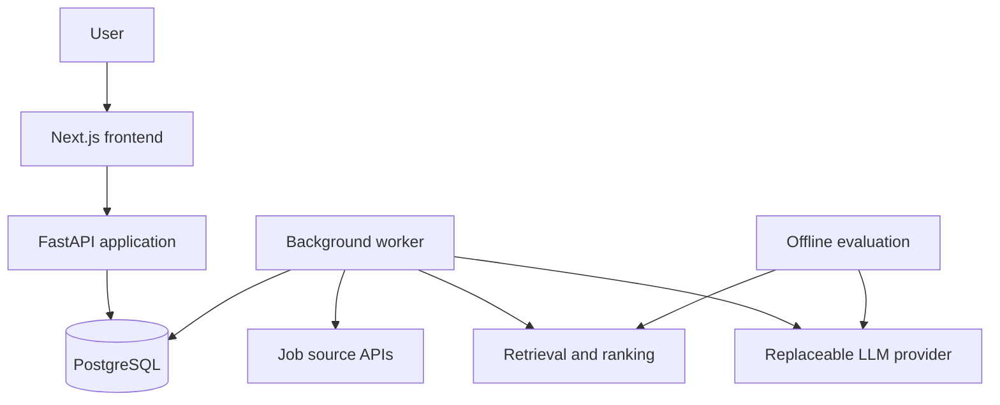

# PathWise

An AI-powered career assistant for discovering relevant jobs, understanding resume–job fit, preparing application materials, and tracking applications.

PathWise combines **evidence-grounded matching**, **reliable agent workflows**, and **measurable AI evaluation**. It is also a learning and portfolio project for Software Engineering and Applied AI Engineering: each major component should have an explainable design, a working implementation, and meaningful validation.

> **Status: initial engineering skeleton.** A Next.js homepage and FastAPI health endpoint are implemented. Product workflows and benchmark results are not available yet. The architecture and capabilities below describe the intended direction.

## Product goals

The intended user journey is:

```text
Import resume and preferences
    → Discover jobs
    → Rank candidates
    → Review supporting evidence and gaps
    → Review resume suggestions
    → Track applications
```

Planned capabilities:

- Import and version resumes, with user review of parsed information.
- Import job descriptions manually and from selected company/ATS sources.
- Deduplicate postings and preserve job-description changes.
- Rank jobs using lexical and semantic retrieval.
- Map job requirements to specific resume passages and highlight uncertainty.
- Draft resume changes grounded in the user's actual experience.
- Save jobs and track application stages.
- Support an agent that searches, analyzes, refines a shortlist, and asks for clarification when needed.
- Later, explore contact research and networking drafts.

Missing evidence means **“not demonstrated in this resume,”** rather than proof that a candidate lacks a skill. External messages and application submissions require explicit user approval.

### MVP boundary

The MVP supports job discovery, matching, reviewable resume suggestions, and **application tracking**. Users submit applications themselves on the employer's site and manually update their application status in PathWise. PathWise does not fill application forms, upload materials to employers, or submit applications in the MVP. The adaptive agent described below is a post-MVP extension; the MVP uses a fixed search–rank–analyze workflow.

The longer-term product vision includes **automated application submission after explicit user approval**, initially for selected supported integrations. This is deferred until integration feasibility, submission permissions, duplicate prevention, and reliable outcome verification have been established. Approval alone does not make a submission integration available. Automated outreach is also outside the MVP.

## Initial data source and freshness

The first planned connector is the official [Greenhouse Job Board API](https://docs.greenhouse.io/job-board), starting with one explicitly configured company board. Its public GET endpoints require no authentication:

```text
GET https://boards-api.greenhouse.io/v1/boards/{board_token}/jobs?content=true
```

This retrieves a particular board's postings, not all Greenhouse jobs or the entire job market. Board tokens will be curated from company career pages. Manual JD text import will provide a development fallback; arbitrary URL scraping and third-party aggregators are outside the initial connector scope.

The official documentation establishes API feasibility, but an end-to-end fetch has not yet been verified in this environment: the terminal request failed DNS resolution and the browser fetch was unavailable. Selecting and successfully fetching a real board is the first implementation gate.

Freshness must use explicit timestamp semantics:

| Field | Meaning |
| --- | --- |
| `source_published_at` (nullable) | Source-provided publication time, only when its meaning is verified |
| `source_updated_at` (nullable) | Source-reported update time; never a substitute for publication time |
| `first_seen_at` | First time PathWise observed this posting |
| `last_seen_at` | Last successful import in which this posting was present |
| `last_checked_at` | Last successful complete check of the source board, stored on the source |

Without verified publication timestamps, the UI must say **“recently discovered by PathWise”**, not **“newly posted.”** The first import is an initial snapshot, not a batch of newly published jobs. Importing manually supplied text does not verify that a vacancy remains open.

Start with a proposed six-hour polling interval per board and display the last successful check. This is a polling target, not a real-time freshness guarantee. Respect source limits, back off on transient failures, and retain the previous successful snapshot on failure. A missing posting should be marked unavailable only after two consecutive successful complete imports omit it; failed or incomplete imports must not close jobs.

Connector acceptance criteria: successfully fetch one real board, retain source identifiers and provenance, import without duplicates on a second run, preserve content changes as versions, and distinguish source failures from removed postings.

## Proposed architecture

Start with a modular monolith and a separate background worker. Introduce additional infrastructure only when requirements justify it.



| Component | Proposed technology | Responsibility |
| --- | --- | --- |
| Frontend | Next.js, TypeScript, Tailwind CSS | Job browsing, evidence review, approvals, application tracking |
| Backend | Python, FastAPI | APIs, validation, ownership checks, workflow control |
| Database | PostgreSQL | Jobs, resume versions, task state, applications |
| Background execution | Independent Python worker | Imports, embeddings, model calls, recoverable tasks |
| Lexical retrieval | BM25 | Baseline ranking and exact terminology |
| Semantic retrieval | Sentence Transformers; pgvector when needed | Embedding generation and vector retrieval |
| Ranking experiments | Hybrid retrieval, optional cross-encoder | Compare quality against simpler baselines |
| LLM integration | Replaceable provider interface | Structured extraction, evidence analysis, drafting |
| Validation and delivery | pytest, evaluation scripts, Docker, GitHub Actions | Correctness, reproducibility, deployment |

A PostgreSQL-backed task queue is an initial candidate. Redis/Celery, LangGraph, and dedicated tracing tools remain options to evaluate. Model choices have not been finalized.

## Matching and evidence

The planned matching pipeline separates retrieval from analysis:

1. Retrieve candidate jobs with BM25, embeddings, or a hybrid approach.
2. Apply explicit user filters while keeping unknown qualifications visible.
3. Optionally rerank candidates if experiments justify the added cost.
4. Extract job requirements into a validated structure.
5. Map requirements to resume evidence or mark them as unsupported/unknown.
6. Present ranked jobs, source passages, gaps, and reviewable suggestions.

Analyses should reference specific resume and job-description versions. Quote validation must check that cited text exists in the source; whether that text actually supports the requirement needs separate evaluation.

Retrieval scores are method-specific signals, not calibrated match probabilities. Model-generated statements should never invent experience or silently resolve missing eligibility information.

## Agent design

A fixed workflow follows predefined steps. An agent chooses its next permitted action based on intermediate results.

PathWise's first proposed agent is a **Job Discovery & Analysis Agent**. Given a resume, preferences, and a target shortlist, it can search, inspect evidence, refine its search, or ask the user for clarification.

Planned tools:

```text
search_jobs(query, filters)
rank_jobs(resume_version_id, job_ids)
analyze_job(resume_version_id, job_version_id)
draft_resume_changes(resume_version_id, job_version_id)
```

The model requests tool calls; the backend validates permissions and arguments and executes them. Database operations, deduplication, retries, and approval enforcement remain application responsibilities. A worker executes background work; it may host an agent but is not itself an agent.

Agent execution should support:

- Persistent checkpoints and tool-call records.
- Step, time, and cost limits.
- Recovery from tool failures and process restarts.
- Backend-enforced approval before external actions.
- Visible action summaries, errors, and pending decisions.
- Isolation of untrusted resume/job text from instructions and permissions.

```text
queued → running → waiting_for_user → running → completed
                   ↘ failed / cancelled
```

Implement the fixed search–rank–analyze workflow before adding adaptive agent decisions, so agent behavior can be compared against a working baseline.

## Planned data model

| Entity | Purpose |
| --- | --- |
| `users` | Ownership and career preferences |
| `sources` | Independently importable sources, such as a company's ATS board |
| `jobs` | Stable source-specific identity and current availability |
| `job_versions` | Immutable snapshots of changing job content |
| `ingestion_runs` | Import status, scheduling, attempts, leases, and errors |
| `resume_versions` | Original resume text and versioned parsing results |
| `match_runs` | Resume version, retrieval method, configuration, execution metadata |
| `match_results` | Ranked job versions, scores, evidence analysis |
| `applications` | Application stage and associated resume version |
| `agent_runs` / `agent_steps` | Agent checkpoints and tool execution records |
| `approval_requests` | Proposed actions and user decisions |

Design principles:

- Enforce source-local job identity with `UNIQUE(source_id, external_id)` and idempotent writes. Cross-source deduplication requires separate rules.
- Preserve content versions so historical results remain interpretable.
- Claim tasks in short transactions and perform network requests outside database locks.
- Use leases and ownership tokens to recover abandoned work and reject stale status updates.
- Expect repeated task execution; leases alone cannot prevent duplicate side effects.
- Keep query-critical data relational and flexible provider payloads/configuration in JSONB.
- Enforce ownership checks for private records, keep credentials outside source configuration, and redact sensitive logs.

The first implementation will focus on sources, jobs, job versions, and ingestion runs.

## Evaluation plan

These are proposed experiments; no improvement claims have been measured.

| Area | Comparison | Measurements |
| --- | --- | --- |
| Retrieval | BM25, embeddings, hybrid, hybrid + reranker | Precision@10, NDCG@10, latency |
| Evidence | Extraction and grounding configurations | Evidence precision, unsupported-claim rate, requirement coverage |
| Agent | Fixed workflow vs. adaptive tool selection | Task success, constraint violations, recovery, tool-call count |
| Operations | Models, batching, caching | End-to-end latency, memory, cost per 100 jobs |

Start with a small manually labeled resume–job dataset and explicit relevance criteria. Keep development examples separate from held-out evaluation examples. Record input snapshots, model/configuration versions, and dataset limitations so results can be interpreted and reproduced.

## Roadmap

See [MILESTONES.md](MILESTONES.md) for the detailed Chinese implementation checklist, dependencies, acceptance criteria, and learning goals. M0–M7 deliver the MVP; M8 covers the post-MVP agent, and M9 evaluates submission feasibility.

- [ ] **Ingestion foundation:** import from one source, persist versions, deduplicate, expose task status, and verify failure recovery.
- [ ] **Matching baseline:** import resume text, browse jobs, implement BM25, and create a labeled evaluation set.
- [ ] **Semantic retrieval:** compare embeddings, hybrid retrieval, and optional reranking against the baseline.
- [ ] **Evidence analysis:** extract requirements, validate source quotes, surface uncertainty, and draft grounded resume suggestions.
- [ ] **Application tracking:** save jobs, update application stages, and associate resume versions.
- [ ] **MVP acceptance:** complete discovery, matching, evidence review, resume suggestions, and manual application tracking without automated submission.
- [ ] **Agent workflow:** add bounded tool selection, checkpoints, clarification, and approvals.
- [ ] **Deployment:** package services, document setup, and monitor quality, failures, latency, and cost.

Deferred product direction: evaluate user-approved application submission for selected integrations and contact research/outreach assistance. These are outside MVP acceptance and have no committed delivery date.

Tests, logging, and evaluation should grow alongside the implementation rather than being deferred to the final milestone.

## Learning approach

Each module follows five steps:

1. Define user behavior and failure cases.
2. Understand the concepts and compare design alternatives.
3. Implement a small working slice.
4. Validate correctness and measure outcomes.
5. Document tradeoffs and practice explaining the design in English.

## Getting started

The repository now reserves separate application directories:

```text
frontend/   Next.js + TypeScript frontend
backend/    Python + FastAPI backend
docs/       Architecture and data-source documentation
```

See [frontend startup commands](frontend/README.md) and [backend startup commands](backend/README.md) for the intended local workflow. The homepage checks the backend health endpoint and supports retry on failure. Dependency manifests and local configuration examples are included; PostgreSQL connectivity and Alembic migration tracking are included; domain tables and product workflows are not implemented yet. Frontend and backend development servers will run in separate terminals on ports 3000 and 8000 respectively.

### Local startup (macOS / Linux)

Requirements: Node.js 20.9+, Python 3.10+, and Docker Desktop. Run the following commands from the repository root in two separate terminals.

Start PostgreSQL from the repository root:

```sh
docker compose up -d --wait db
```

See [database setup](docs/database.md) for connection settings, inspection, migrations, and shutdown.

Terminal 1 — backend:

```sh
cd backend
python3 -m venv .venv
source .venv/bin/activate
python -m pip install -r requirements.txt
cp -n .env.example .env
python -m alembic upgrade head
python -m uvicorn app.main:app --reload --host 127.0.0.1 --port 8000
```

Terminal 2 — frontend:

```sh
cd frontend
npm ci
npm run dev
```

Open http://127.0.0.1:3000 and confirm that the homepage reports **Backend connected**. API documentation is available at http://127.0.0.1:8000/docs.

Check the API directly:

```sh
curl http://127.0.0.1:8000/health
```

Expected response: `{"status":"ok","service":"pathwise-api"}`.

For subsequent starts, skip dependency installation and virtual environment creation; activate the backend environment before running Uvicorn. Press `Ctrl+C` in each terminal to stop the services. If a port is already in use, stop the existing server first.

**Next milestone (M0):** verify a real Greenhouse board, document its field/time semantics, and confirm the MVP boundary. The first implementation slice then delivers import → persist → deduplicate → inspect results.
